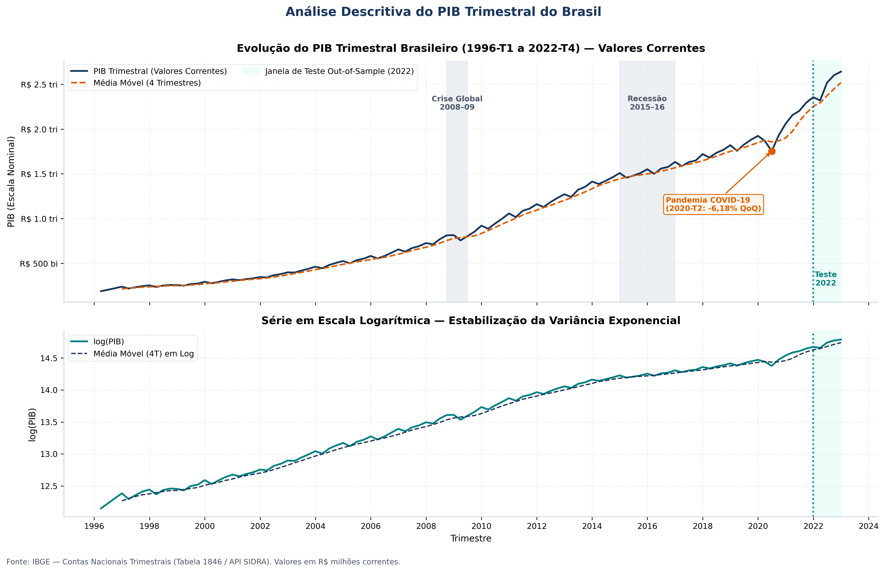
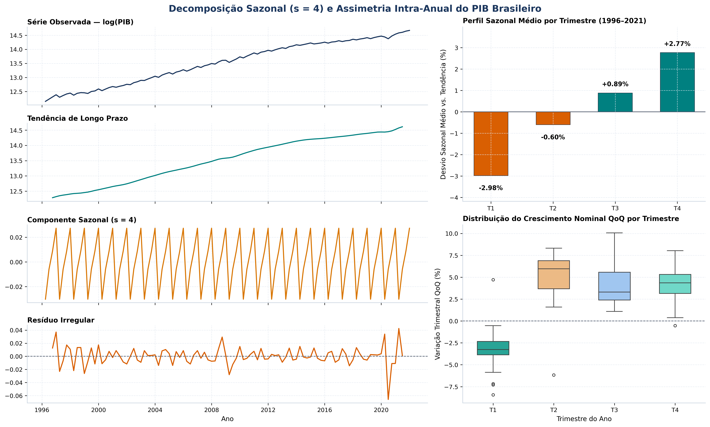
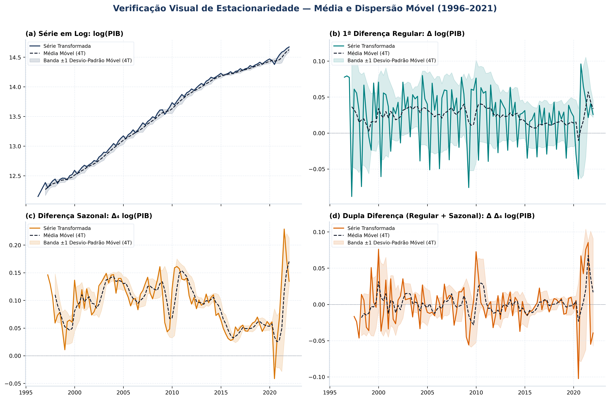
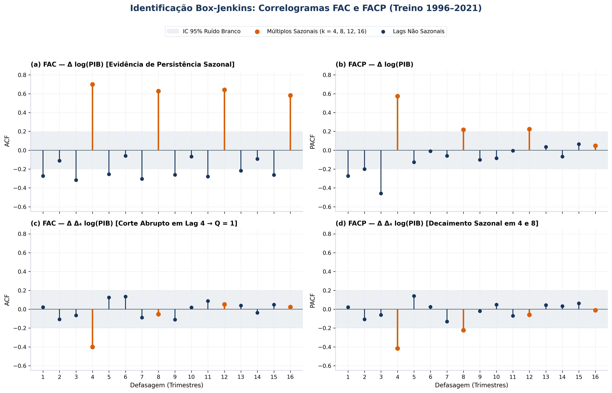
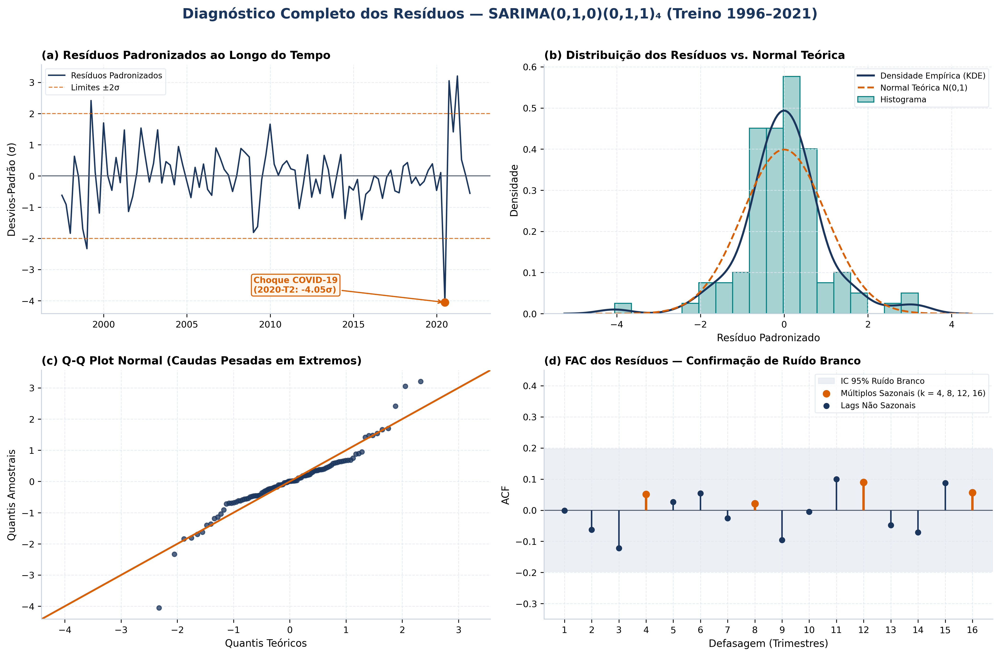
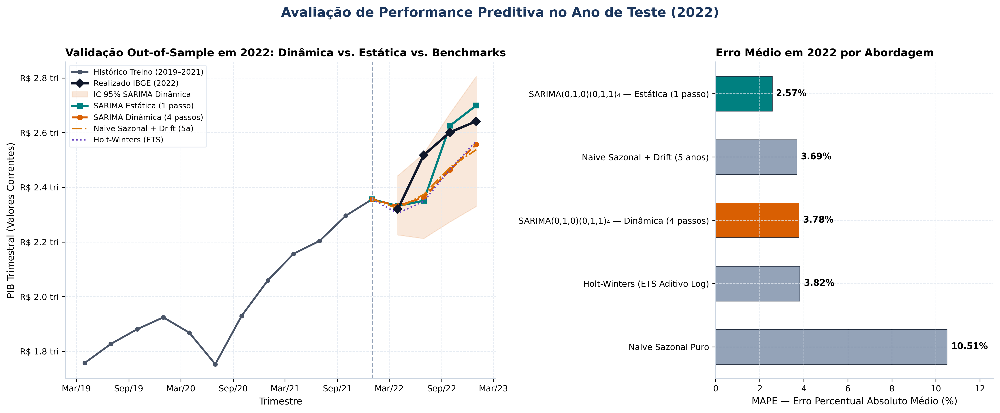
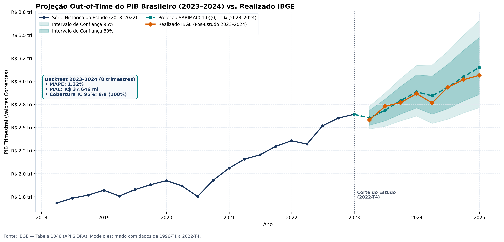

# Previsão do PIB Trimestral Brasileiro — SARIMA & Metodologia Box-Jenkins

[](https://www.python.org/)
[](https://www.statsmodels.org/)
[](https://apisidra.ibge.gov.br/)
[](#pipeline-metodol%C3%B3gico)

> **Português (PT-BR)** | [🌍 English Executive Summary](#-english-executive-summary)

---

## Visão Geral e Objetivo

Este projeto aplica a metodologia econométrica completa de **Box-Jenkins** para modelagem e projeção do **Produto Interno Bruto (PIB) Trimestral do Brasil** a valores correntes (Milhões de R\$), utilizando ingestão automatizada via **API SIDRA do IBGE (Tabela 1846)** com *fallback* offline.

A construção preserva uma separação temporal rigorosa para evitar vazamento de dados (*data leakage*):
- **Amostra de Treino (`1996-T1` a `2021-T4` | 104 trimestres):** Análise exploratória, testes de estacionariedade, identificação de ordens, busca em grade e diagnóstico de resíduos.
- **Validação Out-of-Sample (`2022-T1` a `2022-T4` | 4 trimestres):** Comparação direta entre previsão **Estática** (*one-step-ahead*), previsão **Dinâmica** (*multi-step*) e *benchmarks* clássicos (**Naive Sazonal com/sem Drift** e **Holt-Winters ETS**).
- **Backtest de Mundo Real (`2023-T1` a `2024-T4` | 8 trimestres):** Reestimação do modelo na amostra completa do estudo (`1996-T1`–`2022-T4`) e confronto das projeções com os valores oficiais posteriormente divulgados pelo IBGE.

---

## Destaques e Principais Resultados

- **Estacionariedade Unânime com $d=1, D=1$:** Os testes **ADF**, **Phillips-Perron** e **KPSS** comprovam que $\log(\text{PIB}_t)$ exige diferenciação regular e sazonal ($\Delta\Delta_4 \log \text{PIB}_t$) para eliminar tanto a tendência estocástica quanto a persistência sazonal trimestral ($s = 4$).
- **Especificação Ótima e Parcimoniosa — $\text{SARIMA}(0,1,0)(0,1,1)_4$:** Identificada via correlogramas (`FAC`/`FACP`) e líder simultânea nos critérios **AIC (`-452,86`)**, **BIC (`-447,67`)** e **HQIC (`-450,76`)**, com parâmetro sazonal altamente significativo ($\hat{\Theta}_1 = -0{,}7390$, $p < 0{,}001$) e resíduos validados como ruído branco (Ljung-Box $p > 0{,}52$ em todos os horizontes).
- **Performance na Validação de 2022:**
  - **SARIMA Estática (1 passo à frente):** **MAPE de 2,57%** (`RMSE = R$ 89.317 mi`), superando todos os *benchmarks*.
  - **SARIMA Dinâmica (4 passos à frente):** **MAPE de 3,78%** (`RMSE = R$ 111.820 mi`), superando o modelo *Holt-Winters* (`3,82%`) e o *Naive Sazonal Puro* (`10,51%`).
- **Acurácia em Backtest Pós-Estudo (`2023–2024`):** Ao projetar 2 anos à frente após `2022-T4`, o modelo alcançou **MAPE médio de apenas 1,32%** (`MAE = R$ 37.646 mi`) e **100% de cobertura (8/8 trimestres)** dentro do intervalo de confiança de 95%.

---

## Pipeline Metodológico

```text
API SIDRA/IBGE (Tabela 1846) ─▶ Fallback Local (.xlsx)
        │
        ▼
[1] Análise Exploratória & Decomposição Sazonal (s = 4) em log(PIB)
        │
        ▼
[2] Testes de Raiz Unitária: ADF + Phillips-Perron + KPSS ──▶ d = 1, D = 1
        │
        ▼
[3] Identificação Box-Jenkins: FAC/FACP + Grid Search (AIC/BIC/HQIC) ──▶ SARIMA(0,1,0)(0,1,1)₄
        │
        ▼
[4] Diagnóstico Residual: Ljung-Box (Ruído Branco) + Jarque-Bera + ARCH-LM + Goldfeld-Quandt
        │
        ▼
[5] Validação 2022 (Estática vs. Dinâmica vs. Naive Sazonal + Drift vs. Holt-Winters)
        │
        ▼
[6] Reestimação (1996–2022) & Backtest Pós-Estudo (2023–2024 vs. Realizado IBGE)
```

---

## Resultados Detalhados

### 1. Estacionariedade e Raiz Unitária (Treino: `1996-T1` a `2021-T4`)

| Série | Especificação | ADF $Z(t)$ ($p$-valor) | Phillips-Perron $Z(t)$ ($p$-valor) | KPSS ($p$-valor) | Conclusão |
| :--- | :--- | :---: | :---: | :---: | :--- |
| `PIB (Nível)` | Const. + Tend. | `-0,988` (`0,9458`) | `-0,477` (`0,9843`) | `0,405` (`0,0100`) | Não Estacionária |
| `log(PIB)` | Const. + Tend. | `-2,232` (`0,4720`) | `-1,828` (`0,6909`) | `0,366` (`0,0100`) | Não Estacionária |
| $\Delta \log(\text{PIB})$ | Constante | `-1,607` (`0,4802`) | `-14,713` (`0,0000`) | `0,270` (`>=0,10`) | Parcial (Sazonalidade Residual) |
| $\Delta \Delta_4 \log(\text{PIB})$ | Constante | **`-5,176` (`0,0000`)** | **`-9,498` (`0,0000`)** | **`0,053` (`>=0,10`)** | **Estacionária (3/3)** |

### 2. Diagnóstico dos Resíduos — $\text{SARIMA}(0,1,0)(0,1,1)_4$

| Teste | Escopo | Estatística | $p$-valor | Veredito |
| :--- | :--- | :---: | :---: | :--- |
| **Portmanteau (Ljung-Box)** | Autocorrelação (`lags 4, 8, 12`, `df=1`) | $Q = 2{,}234 \,/\, 2{,}744 \,/\, 5{,}810$ | `0,5253` / `0,9077` / `0,8858` | **Ruído Branco** |
| **Goldfeld-Quandt** | Estabilidade de Variância (1ª vs. 2ª metade) | $F = 1{,}142$ | `0,3221` | **Variância Estável** |
| **Jarque-Bera** | Normalidade (`Assimetria = -0,112`, `Curtose = 6,360`) | $\chi^2 = 46{,}780$ | `< 0,0001` | Caudas pesadas (choque COVID-19 `2020-T2`) |
| **ARCH-LM** | Heterocedasticidade condicional (`4 lags`) | $LM = 20{,}297$ | `0,0004` | Volatilidade pontual na pandemia |

### 3. Validação Out-of-Sample em `2022` (`2022-T1` a `2022-T4`)

| Abordagem | RMSE (R\$ mi) | MAE (R\$ mi) | MAPE (%) |
| :--- | :---: | :---: | :---: |
| **`SARIMA(0,1,0)(0,1,1)₄` — Estática (1 passo)** | **89.317** | **65.205** | **2,57%** |
| `Naive Sazonal + Drift` (Média YoY 5 anos: `7,70%`) | 109.736 | 95.012 | 3,69% |
| **`SARIMA(0,1,0)(0,1,1)₄` — Dinâmica (4 passos)** | **111.820** | **97.095** | **3,78%** |
| `Holt-Winters` (ETS Aditivo em Log) | 114.574 | 97.899 | 3,82% |
| `Naive Sazonal Puro` | 273.751 | 266.884 | 10,51% |

### 4. Backtest Pós-Estudo: Projeção `2023–2024` vs. Realizado IBGE

| Trimestre | Projetado SARIMA (R\$ mi) | IC 95% (R\$ mi) | Realizado IBGE (R\$ mi) | Erro (%) | No IC 95%? |
| :--- | :---: | :---: | :---: | :---: | :---: |
| `2023-T1` | 2.603.012 | `[2.482.376 ; 2.729.510]` | 2.581.018 | `+0,85%` | Sim |
| `2023-T2` | 2.686.064 | `[2.511.721 ; 2.872.508]` | 2.727.580 | `-1,52%` | Sim |
| `2023-T3` | 2.791.431 | `[2.571.176 ; 3.030.554]` | 2.769.445 | `+0,79%` | Sim |
| `2023-T4` | 2.884.212 | `[2.623.071 ; 3.171.351]` | 2.865.301 | `+0,66%` | Sim |
| `2024-T1` | 2.842.204 | `[2.543.599 ; 3.175.862]` | 2.764.833 | `+2,80%` | Sim |
| `2024-T2` | 2.932.887 | `[2.588.164 ; 3.323.525]` | 2.934.759 | `-0,06%` | Sim |
| `2024-T3` | 3.047.937 | `[2.655.975 ; 3.497.744]` | 3.015.936 | `+1,06%` | Sim |
| `2024-T4` | 3.149.244 | `[2.712.735 ; 3.655.992]` | 3.063.723 | `+2,79%` | Sim |
| **Resumo 2023–2024** | **RMSE: R\$ 46.605 mi** | **MAE: R\$ 37.646 mi** | **MAPE: 1,32%** | — | **8/8 (100%)** |

---

## Galeria Visual do Estudo

| Série Histórica e Transformação Log | Decomposição Sazonal ($s=4$) |
| :---: | :---: |
|  |  |

| Verificação de Estacionariedade | Correlogramas FAC e FACP |
| :---: | :---: |
|  |  |

| Diagnóstico Completo de Resíduos | Validação Out-of-Sample em 2022 |
| :---: | :---: |
|  |  |

### Projeção Out-of-Time (`2023–2024`) vs. Realizado IBGE


---

## Estrutura do Repositório e Como Executar

```text
PIB-Projecao/
├── ARIMA.ipynb                # Notebook principal com narrativa econométrica, código e outputs
├── README.md                  # Documentação executiva bilíngue (PT-BR / EN)
├── requirements.txt           # Dependências Python reproduzíveis
├── serie_historica_pib.xlsx   # Base local de fallback (extração IBGE até 2022-T4)
└── figures/                   # Gráficos exportados em alta resolução (300 DPI)
```

### Execução Local
```bash
git clone https://github.com/<seu-usuario>/PIB-Projecao.git
cd PIB-Projecao
pip install -r requirements.txt
jupyter notebook ARIMA.ipynb
```

---

## 🌍 English Executive Summary

### Brazilian Quarterly GDP Forecasting with Box-Jenkins SARIMA Modeling

This repository presents an end-to-end **macroeconomic time-series forecasting** project modeling Brazil's nominal quarterly GDP (current BRL millions) from **1996-Q1 to 2022-Q4**, with live data ingestion from the **IBGE SIDRA API (Table 1846)** and offline Excel fallback.

#### Methodology & Strict Out-of-Sample Design
1. **Exploratory & Seasonal Analysis:** Log-transformation stabilizes exponential nominal variance, while quarterly decomposition ($s = 4$) reveals a consistent intra-annual pattern (`Q1: -2.98%` trough vs. `Q4: +2.77%` peak).
2. **Stationarity Verification:** Joint unit-root and stationarity testing (**ADF**, **Phillips-Perron**, and **KPSS**) establishes integration order **$d = 1, D = 1$** ($\Delta \Delta_4 \log \text{GDP}_t$ stationary across all three tests, $p < 0.0001$ for ADF/PP).
3. **Model Selection & Diagnostics:** **$\text{SARIMA}(0,1,0)(0,1,1)_4$** is identified via ACF/PACF and selected across a structured grid search (`AIC = -452.86`, `BIC = -447.67`). Residuals pass **Ljung-Box** white-noise checks ($p > 0.52$ at lags 4, 8, 12) and **Goldfeld-Quandt** homoscedasticity ($p = 0.3221$), with excess kurtosis (`6.36`) attributable to the isolated COVID-19 shock in `2020-Q2` (`-4.05σ`).
4. **2022 Out-of-Sample Benchmarking (Trained on `1996-Q1`–`2021-Q4`):**
   - **Static SARIMA (1-step-ahead):** **2.57% MAPE** (`RMSE = R$ 89,317M`), outperforming all benchmarks.
   - **Dynamic SARIMA (4-step-ahead):** **3.78% MAPE** (`RMSE = R$ 111,820M`), beating **Holt-Winters ETS** (`3.82%`) and **Pure Seasonal Naive** (`10.51%`), and closely matching **Seasonal Naive + 5y Drift** (`3.69%`).
5. **Real-World Post-Study Backtest (`2023-Q1`–`2024-Q4`):** Re-estimated on `1996-Q1`–`2022-Q4`, the model forecasts 8 quarters ahead with **1.32% MAPE** (`MAE = R$ 37,646M`) and **100% (8/8 quarters) coverage** inside the 95% confidence cone against actual IBGE releases.

#### Quick Start
```bash
pip install -r requirements.txt
jupyter nbconvert --to notebook --execute --inplace ARIMA.ipynb
```
